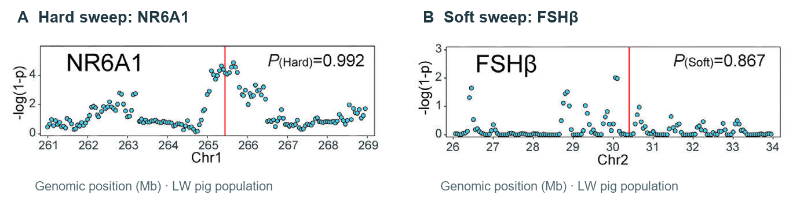
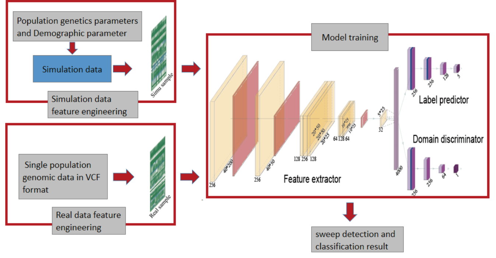
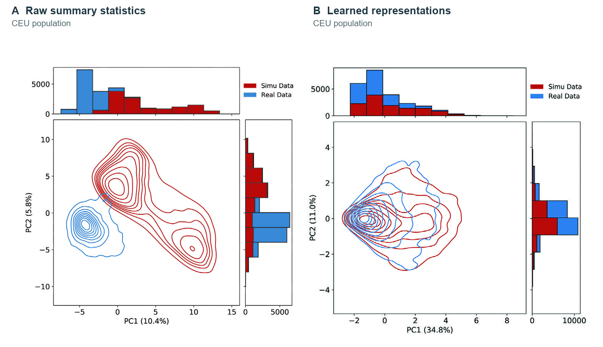

DASDC: Detection and classification of selective sweeps
=======================================================

**DASDC**, short for **D**\ omain **A**\ dversarial **S**\ weep **D**\ etection and **C**\ lassification, is a population-genomics tool for **detecting and classifying selective sweeps within a single population**. It identifies candidate genomic regions and infers whether they have undergone hard or soft selective sweeps, together with the corresponding probabilities (:numref:`sweep-predictions`).

.. _sweep-predictions:

   Hard and soft selective sweep predictions in the LW pig population.
   (A) NR6A1, hard selective sweep; (B) FSHβ, soft selective sweep.

DASDC learns population genomic signatures of selection from simulated data, given the scarcity of selection signals in real genomic data. Specifically, DASDC uses a **domain-adversarial learning framework** to align feature representations between simulated and real genomic data while preserving information relevant to selective sweep classification, improving generalization to real data (:numref:`dasdc-overview-figure`, :numref:`domain-alignment`). The trained model is then applied to phased genomic data in VCF format from the corresponding population to detect and classify selective sweeps.

.. Original overview figure retained byte for byte from the repository manual.
   Source: https://github.com/soo-h/DASweepDetect/assets/74720083/a1205262-6a17-4ec3-84fb-5e82bb92ca4c

.. _dasdc-overview-figure:

   DASDC workflow and model architecture. A shared feature extractor
   supports selective sweep classification and domain alignment.

.. _domain-alignment:

   Alignment of simulated and real CEU data. (A) Raw summary statistics;
   (B) learned representations. PCA axes are computed separately for each panel.

Choose your path
----------------
.. list-table::
   :header-rows: 1
   :widths: 34 66
   :class: path-table

   * - Your goal
     - Start here
   * - Set up DASDC
     - :doc:`Installation <installation>` — requirements, backend selection and environment setup.
   * - Detect selective sweeps
     - Follow the :ref:`six workflow modules <workflow-modules>` below, from parameter preparation and simulation to training and prediction.
   * - Predict with an existing model
     - :doc:`Trained models <models>` — use an existing population-specific model with compatible features for prediction.
   * - Interpret predictions
     - :doc:`Outputs and interpretation <outputs>` — columns, labels and filtering guidance.

.. _workflow-modules:

Workflow modules
----------------

Each module has its own command examples, input/output description and
parameter reference. Click a module name to open its guide.

.. list-table::
   :header-rows: 1
   :widths: 21 29 25 25
   :class: module-table

   * - Module
     - What it does
     - Input
     - Output
   * - :doc:`01 · simu <workflow/simu>`
     - Simulate population-specific training examples with discoal.
     - Simulation configuration files
     - Simulated sequences
   * - :doc:`02 · calc_domain <workflow/calc_domain>`
     - Extract features from the simulated domain.
     - Simulated sequences
     - Simulated feature maps (``.npy``)
   * - :doc:`03 · calc_target <workflow/calc_target>`
     - Extract features and genomic positions from the target population.
     - Phased VCF / VCF.GZ files, one chromosome per file
     - Target feature maps + position files
   * - :doc:`04 · data_annotation <workflow/data_annotation>`
     - Assign class labels and prepare training, validation and test sets.
     - Simulated feature maps + label configuration
     - Dataset arrays + label arrays
   * - :doc:`05 · train <workflow/train>`
     - Train a domain-adaptive ensemble using simulated and target features.
     - Labeled datasets + target feature maps
     - TensorFlow or PyTorch ensemble
   * - :doc:`06 · pred <workflow/pred>`
     - Classify genomic windows with a trained ensemble.
     - Ensemble + target features + positions
     - Tab-separated predictions + class probabilities

How the data flows
------------------

The simulation and target-data branches meet during model training
(:numref:`workflow-data-flow`). Prediction then combines the trained
ensemble with target features and genomic positions.

.. _workflow-data-flow:

.. figure:: _static/workflow.svg
   :alt: Simulations pass through simu, calc_domain and data_annotation into train. Real VCF data passes through calc_target into both train and pred. The trained ensemble also feeds pred.
   :class: workflow-figure

   Data flow through the six DASDC modules.

Before you start
----------------

.. list-table::
   :header-rows: 1
   :widths: 24 76

   * - Requirement
     - What to prepare
   * - Population
     - Analyze one population at a time.
   * - Genomic data
     - Phased, single-population VCF or VCF.GZ files split by chromosome.
   * - Simulation parameters
     - Population-specific mutation and recombination rates, selection strength and demographic parameters. See :doc:`parameter_inference` and :ref:`simulation-configuration`.
   * - Computing environment
     - Linux x86-64; recommended starting resources: 8 CPU cores, 18 GB RAM and 200 GB disk. See :doc:`installation` for backend compatibility.
   * - Example inputs
     - The clone includes simulation and label configurations. Supply real VCF data yourself; larger examples and models are available from `Mendeley Data <https://data.mendeley.com/datasets/vdg2nbpc4j>`_.

.. note::

   TensorFlow is the default backend and requires Python 3.8–3.9;
   PyTorch is optional. Both support CPU and GPU execution. See
   :doc:`installation` for backend setup and GPU requirements. Training
   and prediction must use the same backend.

About the method
----------------

For the model architecture, evaluation and applications to real genomic
data, see the `DASDC paper <https://doi.org/10.1002/advs.202304842>`_.

If you use DASDC, please cite:

   Hui Song, Jinyu Chu, Wangjiao Li, *et al.* A Novel Approach Utilizing Domain
   Adversarial Neural Networks for the Detection and Classification of
   Selective Sweeps. *Advanced Science*. 2024;11(14):e2304842.
   `doi:10.1002/advs.202304842 <https://doi.org/10.1002/advs.202304842>`_.

Report bugs and usage problems through the
`GitHub issue tracker <https://github.com/soo-h/DASweepDetect/issues>`_.

.. toctree::
   :hidden:
   :maxdepth: 2
   :caption: Get started

   Overview <self>
   installation

.. toctree::
   :hidden:
   :maxdepth: 1
   :caption: Workflow

   1. Simulation <workflow/simu>
   2. Simulated features <workflow/calc_domain>
   3. Target features <workflow/calc_target>
   4. Data annotation <workflow/data_annotation>
   5. Model training <workflow/train>
   6. Prediction <workflow/pred>

.. toctree::
   :hidden:
   :maxdepth: 1
   :caption: Reference

   parameter_inference
   outputs
   models
   faq
