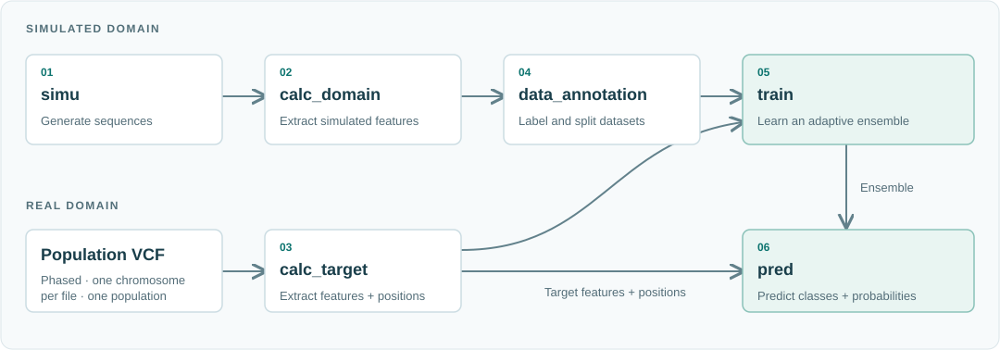

.. _complete-workflow:

Detect selective sweeps from scratch
====================================

Start with population-specific parameters and phased genomic data. Generate
simulated training data, extract features and train a model, then use it to
detect and classify selective sweeps. If you already have a matching model,
follow :ref:`detection with an existing model <two-step-workflow>`.

.. _before-you-start:

Before you start
----------------

.. list-table::
   :header-rows: 1
   :widths: 24 76

   * - Requirement
     - What to prepare
   * - Population
     - Analyze one population at a time.
   * - Genomic data
     - Phased, single-population VCF or VCF.GZ files split by chromosome.
   * - Simulation parameters
     - Population-specific mutation and recombination rates, selection strength and demographic parameters. See :doc:`../parameter_inference` and :ref:`simulation-configuration`.
   * - Computing environment
     - Linux x86-64; recommended starting resources: 8 CPU cores, 18 GB RAM and 200 GB disk. See :doc:`../installation` for backend compatibility.
   * - Example inputs
     - The clone includes simulation and label configurations. Supply real VCF data yourself; larger examples and models are available from `Mendeley Data <https://data.mendeley.com/datasets/vdg2nbpc4j>`_.

.. note::

   TensorFlow is the default backend and requires Python 3.8–3.9;
   PyTorch is optional. Both support CPU and GPU execution. See
   :doc:`../installation` for backend setup and GPU requirements. Training
   and prediction must use the same backend.

.. _workflow-modules:

Workflow modules
----------------

The complete workflow has six modules. Each link opens its command examples,
inputs and outputs.

.. list-table::
   :header-rows: 1
   :widths: 34 66
   :class: module-table

   * - Module
     - Function
   * - :doc:`1. simu <simu>`
     - Generate population-specific simulated training sequences.
   * - :doc:`2. calc_domain <calc_domain>`
     - Extract features from simulated sequences.
   * - :doc:`3. calc_target <calc_target>`
     - Extract real-data features and genomic positions from phased VCF data.
   * - :doc:`4. data_annotation <data_annotation>`
     - Assign class labels and prepare training, validation and test arrays.
   * - :doc:`5. train <train>`
     - Train a population-specific model with simulated and real-data features.
   * - :doc:`6. pred <pred>`
     - Detect and classify selective sweeps and report their probabilities.

See :doc:`../outputs` for prediction columns and interpretation.

.. _how-the-data-flows:

How the data flows
------------------

The simulated and real-data branches meet during training
(:numref:`workflow-data-flow`). Prediction combines the trained model with
target features and genomic positions.

.. _workflow-data-flow:

   Data flow through the six DASDC modules.

Begin with :doc:`parameter preparation <../parameter_inference>` and
:doc:`simulation <simu>`.
